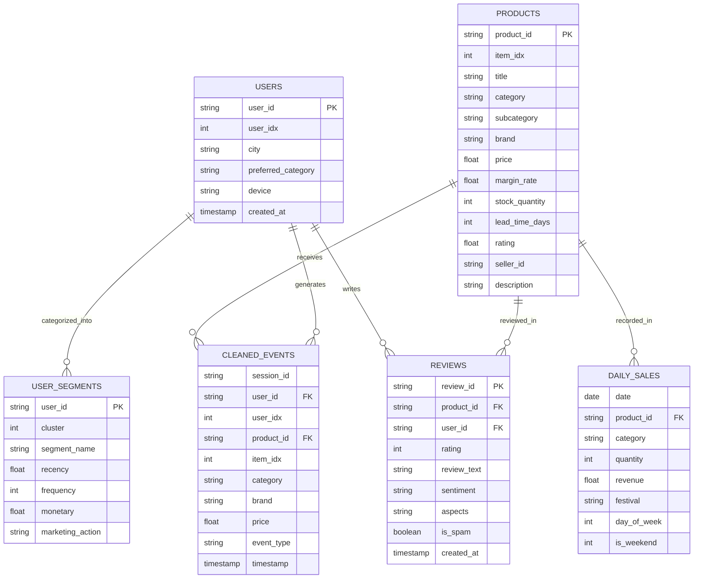

# System Architecture & Technical Specification
## ShopKaro AI Commerce Intelligence Platform

### 1. High-Level Architectural Diagram

```

---

### 1.1 Data Model (Entity-Relationship Diagram)

```mermaid
erDiagram
    USERS ||--o{ CLEANED_EVENTS : generates
    PRODUCTS ||--o{ CLEANED_EVENTS : receives
    USERS ||--o{ USER_SEGMENTS : categorized_into
    PRODUCTS ||--o{ DAILY_SALES : recorded_in
    PRODUCTS ||--o{ REVIEWS : reviewed_in
    USERS ||--o{ REVIEWS : writes

    USERS {
        string user_id PK
        int user_idx
        string city
        string preferred_category
        string device
        timestamp created_at
    }

    PRODUCTS {
        string product_id PK
        int item_idx
        string title
        string category
        string subcategory
        string brand
        float price
        float margin_rate
        int stock_quantity
        int lead_time_days
        float rating
        string seller_id
        string description
    }

    CLEANED_EVENTS {
        string session_id
        string user_id FK
        int user_idx
        string product_id FK
        int item_idx
        string category
        string brand
        float price
        string event_type
        timestamp timestamp
    }

    USER_SEGMENTS {
        string user_id PK
        int cluster
        string segment_name
        float recency
        int frequency
        float monetary
        string marketing_action
    }

    DAILY_SALES {
        date date
        string product_id FK
        string category
        int quantity
        float revenue
        string festival
        int day_of_week
        int is_weekend
    }

    REVIEWS {
        string review_id PK
        string product_id FK
        string user_id FK
        int rating
        string review_text
        string sentiment
        string aspects
        boolean is_spam
        timestamp created_at
    }
```mermaid
flowchart TD
    subgraph Data_Layer ["Data Layer (Storage & Ingestion)"]
        RawEvents["Raw User Events (520k+)"]
        Catalog["Product Catalog (50k SKUs, PKR)"]
        DuckDB[("DuckDB OLAP Engine")]
        Cleaner["Event Cleaning & 30-min Inactivity Sessionizer"]
        
        RawEvents --> Cleaner
        Catalog --> DuckDB
        Cleaner --> DuckDB
    end

    subgraph Feature_Layer ["Feature Engineering & Splitting"]
        RFM["RFM & K-Means Segmentation"]
        Splits["Strict Chronological Split (Train / Val / Test)"]
        ColdSets["Cold-Start Sets (Unseen Users & Items)"]
        
        DuckDB --> RFM
        DuckDB --> Splits
        Splits --> ColdSets
    end

    subgraph ML_Engines ["Machine Learning Subsystems"]
        RecSys["Hybrid Two-Tower & Implicit ALS"]
        Forecaster["Global LightGBM Demand Forecaster (P10/P50/P90)"]
        SearchNLP["Hybrid BM25 + Dense Semantic RRF Engine"]
        Assistant["Grounded UrduLish Assistant Agent"]
        ReviewNLP["Multilingual Aspect & Sentiment Classifier"]
        
        Splits --> RecSys
        DuckDB --> Forecaster
        Catalog --> SearchNLP
        SearchNLP --> Assistant
        DuckDB --> ReviewNLP
    end

    subgraph Serving_Layer ["Real-Time Serving & Caching"]
        FastAPI["FastAPI Async Microservices"]
        RedisCache[("Redis / In-Memory Sub-10ms Cache")]
        Reranker["Business Rules & Diversity Filter"]
        
        RecSys --> Reranker
        Reranker --> RedisCache
        Forecaster --> FastAPI
        Assistant --> FastAPI
        ReviewNLP --> FastAPI
        RedisCache --> FastAPI
    end

    subgraph Presentation_Layer ["Cinematic UI 2.0 Frontend"]
        CustView["Customer Experience (Personalized Storefront)"]
        OpsView["Operations Command (Forecasts & Stock-Out Alerts)"]
        MgmtView["Executive Command (A/B Test & RFM Segments)"]
        Terminal["UrduLish Assistant Floating Terminal"]
        
        FastAPI --> CustView
        FastAPI --> OpsView
        FastAPI --> MgmtView
        FastAPI --> Terminal
    end
```

---

### 1.1 Data Model (Entity-Relationship Diagram)



---

### 2. Core Architectural Components

#### 2.1 Storage & OLAP Pipeline (DuckDB)
* **DuckDB Storage**: Embeds high-throughput columnar analytics for processing 522k+ interaction events, 50,000 SKUs, and 365,000 daily sales records without cloud database overhead.
* **Cleaning Pipeline**: Purges network duplicates, flags rapid-click bot sessions (>1000 events/session), and clusters human interactions using the **30-minute inactivity boundary** rule.
* **Temporal Splitting**: Chronological train/validation/test partitions ($70\% / 15\% / 15\%$) prevent lookahead bias and accurately emulate production deployment.

#### 2.2 Recommender Subsystem (Day 2)
* **PyTorch Two-Tower Architecture**: Maps user identity + behavioral segment and item attributes + text description into a shared 64-dimensional latent embedding space.
* **Implicit ALS Matrix Factorization**: Utilizes Hu-Koren-Volinsky confidence weighting ($\alpha = 40$) over implicit interaction types (views=1, carts=3, purchases=5).
* **Business Rules Re-Ranking Layer**:
  - Out-of-stock elimination (`stock_quantity == 0`).
  - Suppression of user's already purchased items.
  - Brand diversity ceiling (maximum 2 items from the same brand in Top-10).
  - Margin boost (+25% score multiplier for items with margin $> 30\%$).
  - Festival boost (+40% score boost for Lawn and festive attire before Eid).
* **Association Mining**: Mines complementary item associations (Apriori co-occurrence) with natural UrduLish explanations.

#### 2.3 Demand Forecasting & Inventory Engine (Day 3)
* **Global Multi-Feature LightGBM Model**: Trained across all catalog items using multi-horizon lag features (`lag_1`, `lag_7`, `lag_14`, `lag_28`), rolling 7-day and 28-day moving means/variances, and Pakistani calendar features.
* **Shifting Islamic Calendar Handling**: Accurately accounts for lunar holiday drift (~10–11 days earlier each Gregorian year) for Ramadan, Eid ul Fitr, and Eid ul Adha.
* **Probabilistic Quantiles**: Outputs P10, P50, and P90 demand distributions to model warehouse replenishment risks.
* **Safety Stock & Reorder Points**: Computes dynamic safety stock ($SS = Z \times \sqrt{L} \times \sigma$) at 95% service levels.

#### 2.4 Hybrid Search & Grounded Agent (Day 4)
* **Hybrid RRF**: Combines BM25 token frequencies with dense TF-IDF semantic embeddings via Reciprocal Rank Fusion ($k=60$).
* **Query Understanding**: Parses Roman Urdu budgets (`under 5000`, `1.5 lac`, `20 hazaar tak`), occasions (`eid`, `shaadi`), and categories.
* **Strict Tool-Grounded Assistant**: Every recommended product, price, stock level, and order status is fetched exclusively from verified internal tools. Zero hallucinations.

#### 2.5 Real-Time Serving & Caching (Day 5)
* **FastAPI Async Engine**: RESTful endpoints with sub-10ms response time when cached, safely satisfying the client's <100ms latency SLA.
* **Redis Caching**: Hot user recommendations are pre-computed in batch and cached; recent in-session clicks dynamically re-rank recommendations on the fly.

